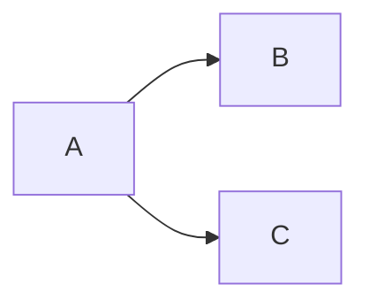

# PolyErgalio


---

## Overview

**PolyErgalio** (Greek for "multiple tools") is a collection of implemented machine learning methods ranging from  
data encoding and processing pipelines to supervised learning and clustering.

The focus of this repository is:
- **Classic and alternative ML algorithms implemented with a unified 
  interface**
- **Numerical stability and performance**
- **Novel extensions and original research contributions**

All algorithms are implemented in **NumPy** and **SciPy**, with minimal external dependencies.

---
## Installation

```bash
pip install polyergalio
```

For local development:

```bash
pip install -e ".[test]"
```
---
## Layout / Inheritance
|--> Serializable
|-------> Composite Base Class
|--------------> Network
|--------------> Feature Pipeline
|--------------> CompositeNode (NOT SUBCLASSES)
|
|-------> BasalEstimator
|--------------> Layer
|--------------> Processor (feature processing)
|--------------> FittedModel
|--------------> 
|--> 

### Encoders

### Generators

### Models

## Transforms

Post hoc Probability Calibrations
- PAVA (Pooled Adjacent Violators Algorithm) step function powers our methods 
- Platt Scaling - Least sum of weighted squares / Newtonian grid search with label smoothing
- Isotonic Regression - PAVA  fits a non-decreasing step function.
- Spline - Fit a monotonic, Cubic Hermite Spline
  - Apply PAVA to get monotone (score, probability) pairs 
  - Deduplicate tied scores 
  - calc derivatives at each knot that guarantee monotonicity


## Visuals 


---
## Implemented Methods

### 🔹 Encoding and Embedding Creation
`src/polyergalio/encoders/*`
- Categorical variable pipeline
- Chronological variable (cyclical and absolute) pipeline
- Numeric (normalized and raw) pipeline
- Trainable Fourier Embedding pipeline
- Trainable Text embedding pipeline
- tokenization with sentencepiece

### 🔹 Toy Dataset Generation
`src/polyergalio/generators/*`

### 🔹 Supervised Learning
`src/polyergalio/models/supervised/*`
#### Scaled Conjugate Gradient (SCG)
- SCG for gradient descent applied to regression and logistic regression 
  *(Møller); (Anderson)*
- SCG regression with **Elastic Net regularization** *(novel)*
- SCG classification:
  - Binary
  - Multinomial
  - Multilabel

#### Relative Weights (RW)
- Johnson’s Relative Weights regression *(Johnson)*
- Relative Weights applied to logistic regression  
  *(Solís & Pasquier); (Tonidandel & LeBreton)*

#### Tree Algorithms (EBM / EBTM)
- Tree algorithms - Explainable Boosted-Tree Model (EBM)

### 🔹 Unsupervised Learning & Clustering
`src/polyergalio/models/clustering/*`
#### Self-Organizing Maps
- Self Organizing Maps, Parameterless Self-Organizing Maps - PLSOM  
  *(Kohonen); (Berglund & Sitte)*
  - Clustering and dimensionality reduction without hyperparameter adjustment
- Growing Self Organizing Maps, Parameterless (grid)
- Grid-free Growing Parameterless Self Organizing Maps
  - FreeSOM - grows and shrinks under conditional updates
  - *(novel)* fusion of Neural Gas and PLSOM


#### Centroid Neural Networks (CENTNN)
- Novel **Centroid Neural Network** for fast clustering and optimization  
  *(Park, Dong-Chul)*
- CENTNN with **N-dimensional density modeling**
- *(novel)*

---
## Status

**Active research / experimental**  
APIs may change as methods are refined and extended.

---
## Authors and Contributors
- "David Graey", "graeyband@gmail.com"
- "Dr Charles Anderson", "Chuck.Anderson@colostate.edu"

---
## References

Primary academic references are cited inline.  
Full bibliographic references may be added in `/docs` in the future.

https://packaging.python.org/en/latest/tutorials/packaging-projects/

https://packaging.python.org/en/latest/tutorials/creating-documentation/


# Visuals & Diagrams
https://mermaid.js.org/config/Tutorials.html

