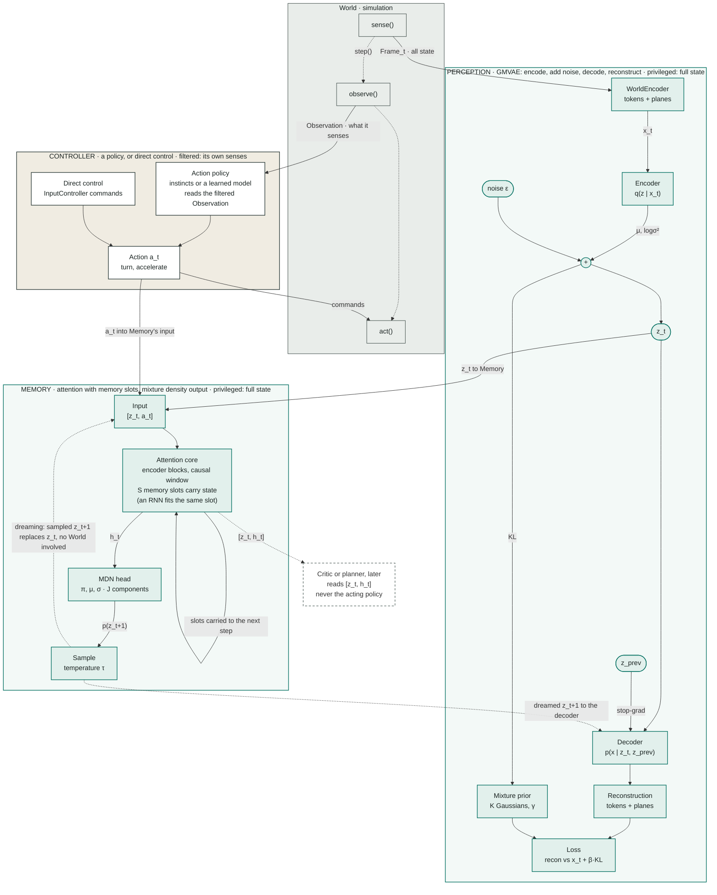

# World Model blocks

Perception compresses the whole world into a latent. Memory predicts the next latent and can dream. The Controller acts. Teal parts see everything; the Controller sees only what its own entity senses.

**Legend.** Teal nodes are privileged: the full world state, or derived from it. White nodes are per entity: what it senses and what it does. Dashed edges are dreaming or an optional later consumer.

Perception turns each full-state frame into a latent `z_t`. Memory turns the latent sequence plus the controlled vehicles' actions into a density over `z_t+1`. The Controller closes the loop on the World and feeds its action into Memory.

## Notes

**Training order.** Perception first, then frozen. Memory trains on Perception's stored latents. The Controller is independent of both.

**Previous latent.** `z_prev` is the previous tick's mean with no gradient. A learned start vector replaces it at the start of a segment and half the time elsewhere.

**Dreaming.** Memory samples `z_t+1` at temperature τ and feeds it back as the next input. Perception's decoder renders each dreamed latent as a world state.

**Privilege boundary.** The action policy reads only its filtered observation. `[z_t, h_t]` is for a critic or planner, so partial observability survives.
